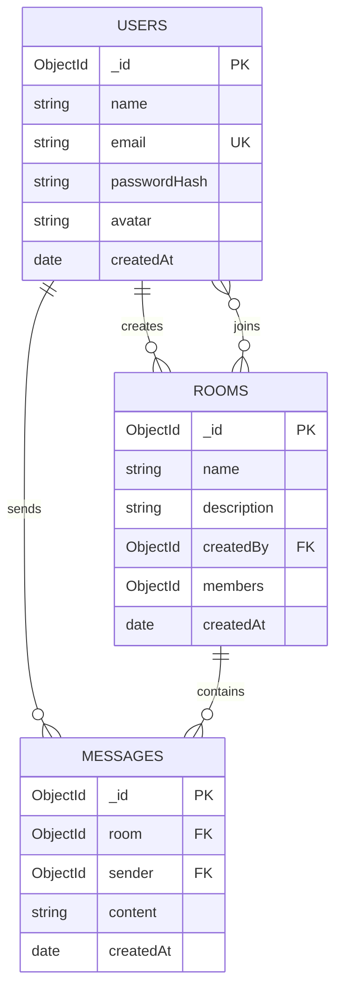

# Database Schema — Real-Time Chat App

## Database
MongoDB

## Collections

### 1. Users
- _id: ObjectId
- name: String
- email: String (Unique)
- passwordHash: String
- avatar: String
- createdAt: Date

### 2. Rooms
- _id: ObjectId
- name: String
- description: String
- createdBy: ObjectId (Reference: Users)
- members: Array of ObjectIds (Reference: Users)
- createdAt: Date

### 3. Messages
- _id: ObjectId
- room: ObjectId (Reference: Rooms)
- sender: ObjectId (Reference: Users)
- content: String
- createdAt: Date

## Relationships
- One user can create multiple rooms.
- One user can join multiple rooms.
- One user can send multiple messages.
- One room can contain multiple messages.

## Indexes
- Users: Unique index on email.
- Messages: Compound index on room and createdAt.

## Real-Time Data
Socket.IO will manage online users and typing
indicators. These are temporary states.

## Database Relationship Diagram

